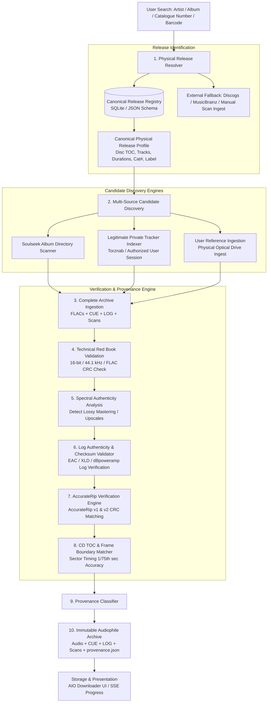
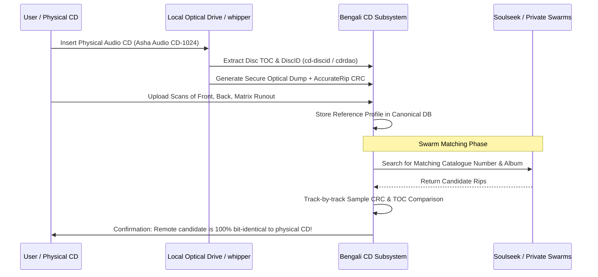
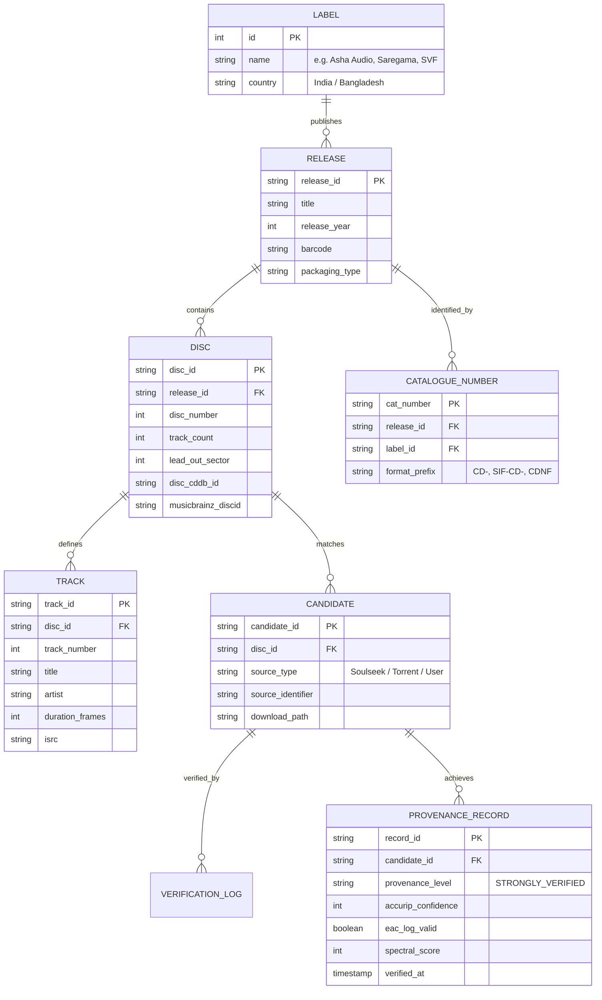

# Bengali 1:1 CD-Rip Collection — Future Implementation Plan

**Target Application:** All-In-One (AIO) Downloader (`uniloader.dpdns.org`)  
**Scope:** Architecture Design & Implementation Planning (Explanation & Design Only)  
**Status:** **PLANNING ONLY — NO CODE OR CONFIGURATION MODIFIED**  
**Classification Guide:**
- `[CURRENTLY IMPLEMENTED]`: Features actively operating in production.
- `[PLANNED]`: Core proposed features for Bengali CD-rip acquisition and verification.
- `[OPTIONAL FUTURE FEATURE]`: Advanced enhancements subject to external dependencies.

---

## 1. Objective

The objective of this future architecture is to design a dedicated subsystem within the AIO Downloader capable of discovering, acquiring, verifying, and archiving **authentic 1:1 physical Audio CD releases** of Bengali music. 

This specifically targets catalog releases manufactured and distributed on compact disc by historic and contemporary regional labels, including:
- **Asha Audio**
- **Saregama / HMV India (Gramophone Company of India)**
- **Sony / Sony DADC India**
- **Shree Venkatesh Films (SVF)**
- **SIF**
- **Time Music**
- **Sagarika Music**
- **Angel Digital**
- **Bhavna Records**
- **Cozmic Harmony / Beethoven Records**

### Beyond "Lossless FLAC"
The target is **not** simply obtaining "any lossless audio bitstream" (such as a 16-bit/44.1 kHz or 24-bit/96 kHz stream downloaded from Tidal, Qobuz, Apple Music, or Deezer). Modern streaming platforms frequently serve remastered digital masters with altered dynamic compression, brickwall limiting, revised EQ curves, resampled rates, or different track edits. 

Instead, the target is a **bit-for-bit, 1:1 digital representation of a specific commercial plastic compact disc pressing**, preserving the disc's native Red Book PCM audio, pre-gap timings, sector boundaries, and associated artwork/packaging documentation.

### Provenance Spectrum
The future system must programmatically classify candidate audio into five clear provenance tiers:
- **Tier A (Generic Lossless Web FLAC):** Verified lossless PCM stream originating from a digital streaming service or web store (e.g. Tidal Hi-Res, Deezer HiFi, Qobuz). Not a physical CD release.
- **Tier B (Unknown-Source FLAC):** Lossless FLAC stream lacking rip logs, cue sheets, provenance tags, or folder context.
- **Tier C (CD-Quality FLAC with Uncertain Provenance):** 16-bit / 44.1 kHz FLAC that passes spectral authenticity tests (no lossy cutoff), but lacks cryptographic rip logs or AccurateRip verification.
- **Tier D (Credible CD Rip):** Lossless rip containing an EAC, XLD, or dBpoweramp extraction log, a valid cue sheet, and track durations consistent with physical CD sectors, but lacking independent multi-source checksum verification.
- **Tier E (Strongly Verified 1:1 Physical-CD Rip):** Lossless rip confirmed via an **AccurateRip v1/v2 database match**, a tamper-verified 100% secure extraction log with valid drive offset, an exact CD Table of Contents (TOC) match, and complete physical packaging scans (front, back, tray, and matrix runout).

> [!IMPORTANT]
> **Spectral analysis alone does NOT prove CD provenance.** An uncompressed 16-bit / 44.1 kHz Web download from Bandcamp or Qobuz displays identical spectral Nyquist characteristics to an optical CD rip. CD provenance requires structural, sector, and cryptographic evidence beyond frequency plots.

---

## 2. Current Architecture `[CURRENTLY IMPLEMENTED]`

The existing AIO Downloader FLAC pipeline consists of:
1. **API Gateway & Search (`server.js`):**
   - Direct track searches query the **Apple iTunes Store Search API** (`itunes.apple.com`).
   - Album/torrent searches query **Apibay** (`apibay.org`).
2. **Resolution Pipeline (`audiophile_flac_engine.py`):**
   - **Tier 1:** Tidal Hi-Res via Monochrome API mirrors.
   - **Tier 2:** Soulseek P2P via the local `slskd` daemon (v0.26.0 on port 5030).
   - **Tier 3:** Deezer HiFi (1411 kbps 16-bit FLAC) with Blowfish CBC stream decryption.
3. **P2P Swarm Engine (`soulseek_flac_engine.py`):**
   - Searches Soulseek for single track titles (`clean_art + " " + clean_tit`).
   - Evaluates candidates via `calc_fidelity_score`, which awards massive point bonuses to 24-bit and 32-bit files, large file sizes, and audiophile keywords (`Vinyl`, `SACD`, `Hi-Res`).
   - Transfers the top candidate over a single direct TCP stream with speed and stall watchdogs.
4. **Spectral Verification (`flac_checker.py`):**
   - Uses FFmpeg FFT filters (`firequalizer`/`highpass`) to detect low-pass cutoffs at 16 kHz (128k MP3), 18.5 kHz (192k MP3), and 20 kHz (320k MP3 / YouTube Opus). Rejects fake transcodes.
5. **BitTorrent Subsystem (`server.js` lines 4775–4830):**
   - Spawns `aria2c` with public trackers and DHT enabled (`--enable-dht=true`, `--bt-enable-lpd=true`).
   - Immediately halts upon completion (`--seed-time=0`).
   - No private tracker authentication, no Torznab protocol, no passkey support, and no seeding retention.

### Current Architectural Limitations for Bengali CD Rips
- **Single-Track Focus:** Downloads individual isolated `.flac` tracks rather than complete disc folders with accompanying logs, cues, and artwork.
- **Bit-Depth Bias:** `calc_fidelity_score` favors 24-bit/96 kHz files. If an authentic 16-bit 44.1 kHz Bengali CD rip competes against an upscaled fake 24-bit transcode, the existing algorithm scores the fake 24-bit file higher.
- **Catalogue Ignorance:** Searches strictly on artist and track strings; cannot search or filter by catalogue number (`Asha Audio CD-1024`, `SVF SIF-CD-042`).
- **Disregard of Extraction Artifacts:** Ignores `.cue`, `.log`, and `.accurip` companion files present on remote Soulseek peers.

---

## 3. Proposed Future Pipeline `[PLANNED]`

The planned pipeline decouples single-track streaming resolution from physical CD release archival:



### Step-by-Step Execution
1. **Release Ingestion:** The user enters a search query containing an Artist/Album, or explicitly targets a physical release via Catalogue Number (`Asha Audio CD-1024`).
2. **Release Identification:** The system resolves the canonical physical release profile from an internal repository. If the CD is uncatalogued, the user can input the track list, catalogue number, and expected sector timings.
3. **Candidate Discovery:** The system queries configured sources for complete directory candidates containing matching release identifiers.
4. **Candidate Acquisition:** Downloads the entire candidate release folder (audio tracks, cue sheet, rip log, artwork) into an isolated staging directory.
5. **Technical Validation:** Confirms container integrity, decodes raw audio stream to PCM, and verifies exact 16-bit / 44.1 kHz stereo Red Book parameters.
6. **Spectral Authenticity Verification:** Analyzes high-frequency harmonic energy using FFT firequalizer filters to ensure the studio master was not derived from a lossy MP3/AAC/Opus master.
7. **Log Cryptographic Verification:** Parses any included EAC, XLD, or dBpoweramp extraction log, validating drive read offset, test-and-copy CRCs, track quality percentages, and log digital signatures.
8. **AccurateRip v1/v2 Check:** Calculates AccurateRip track CRCs from the decoded PCM audio and queries the AccurateRip database. A confidence match $> 0$ provides mathematical certainty of bit-perfection against independent global rips.
9. **CD TOC & Frame Alignment:** Verifies that track lengths, pre-gaps, and index offsets align precisely with CD sector boundaries (75 sectors per second).
10. **Provenance Classification:** Assigns a strict provenance rating (`UNKNOWN` to `CD_RIP_STRONGLY_VERIFIED`).
11. **Packaging & Archiving:** Formats the final package with verified metadata, embeds front cover scans, preserves logs/cues, and writes an auditable `provenance.json` manifest.

---

## 4. Release Identity `[PLANNED]`

A physical CD is an industrial artifact, not just an audio file. Its identity must be defined independently of external streaming metadata:

```
Canonical Physical CD Release Identity
├── Label Information (Asha Audio, Saregama, SVF, etc.)
├── Catalogue Number (e.g., "Asha Audio CD-1024", "SVF SIF-CD-042")
├── Barcode / EAN / UPC
├── Matrix Runout & Mastering SID Code (e.g., "DADC INDIA", "IFPI L391")
├── Physical Packaging Details (Digipak, Jewel Case, Booklet Page Count)
├── CD Table of Contents (TOC) (Track count, start sector, lead-out address)
└── Track-by-Track Sector Boundaries (Exact 1/75-second frame counts)
```

### Overcoming Missing Commercial Database Entries
Many physical Bengali CDs from regional labels (such as Asha Audio film releases, Saregama Bengali modern songs, SVF mini-albums) have never been catalogued on Discogs, MusicBrainz, or Gracenote.

To operate without dependence on commercial databases, the system will use an **Internal Canonical Release Profile** format (stored locally in JSON/SQLite):

```json
{
  "releaseId": "bengali_asha_cd_1024",
  "label": "Asha Audio",
  "catalogueNumber": "CD-1024",
  "albumTitle": "Mayabono Biharini",
  "releaseYear": 2001,
  "discCount": 1,
  "barcode": "8903242010245",
  "matrixRunout": "Asha Audio CD-1024 DADC",
  "cdTOC": {
    "trackCount": 8,
    "leadOutSector": 178450,
    "tracks": [
      { "trackNumber": 1, "startSector": 150, "durationFrames": 22350, "isrc": "INA120101024" },
      { "trackNumber": 2, "startSector": 22500, "durationFrames": 19800, "isrc": "INA120101025" }
    ]
  },
  "packaging": {
    "caseType": "Standard Jewel Case",
    "hasBooklet": true,
    "trayColor": "Clear"
  }
}
```

If an external catalog lacks the release, the user can create or export this profile directly from their physical disc or an EAC cue sheet.

---

## 5. Candidate Discovery `[PLANNED]`

### 5.1 Soulseek P2P (`slskd`)
In the future pipeline, Soulseek candidate discovery will be expanded from single-track queries to **Directory-Level Swarm Evaluation**:
1. **Search Query Formulation:** Searches for the exact album title, artist, and catalogue number (e.g. `Asha Audio "Mayabono Biharini"`, `SVF "Chirodini Tumi Je Amar"`).
2. **Directory Inspection:** Rather than matching a single `.flac` file, the engine queries `GET /api/v0/searches/{id}/responses` to inspect the full file tree of the remote peer's folder:
   - Evaluates presence of `.cue` sheet (`album.cue`).
   - Evaluates presence of rip log (`*.log`).
   - Evaluates presence of packaging scans in `Scans/` or `Covers/` (`front.jpg`, `back.jpg`, `cd.jpg`, `matrix.jpg`).
   - Verifies that track count matches the expected physical disc.
3. **Directory Scoring:** Ranks peer folders based on completeness rather than file size alone:
   $$\text{Folder Score} = 10,000 \times \text{Tracks Present} + 50,000 (\text{if .log}) + 30,000 (\text{if .cue}) + 20,000 (\text{if Scans})$$

### 5.2 BitTorrent / Public Trackers
The existing Apibay integration (`apibay.org`) searches public swarms. However, public BitTorrent indexers rarely index regional Bengali physical CD rips with EAC logs. Public indexers will serve as a low-priority fallback for uncatalogued albums.

### 5.3 Private Trackers
Regional private torrent trackers (e.g., BDTorrents, BWTorrents, TorrentsBD, CrazyHD) maintain dedicated internal audiophile release teams that mandate strict Red Book ripping standards (EAC 100% secure rips, non-compliant cue sheets rejected, lossless logs, full 600 DPI scans). Accessing these sources requires dedicated architectural considerations.

---

## 6. Private Tracker Feasibility `[PLANNED]`

### Architectural Analysis of Current vs. Future Capabilities

| Question | Current Implementation Status | Future Feasibility & Design |
| :--- | :--- | :--- |
| **1. Current support for private trackers?** | **No.** Current code only talks to Apibay and iTunes. | Feasible via a dedicated private tracker adapter module. |
| **2. What does existing Apibay provide?** | Public scraping of `apibay.org/q.php?cat=100`, magnet construction with public open trackers. | Must remain strictly separate from private tracker mechanics. |
| **3. Is there Torznab integration?** | **No.** Torznab protocol is not implemented. | Highly recommended: Torznab is the industry-standard XML/JSON API for authenticated tracker queries. |
| **4. Is there Jackett/Prowlarr integration?** | **No.** | Standard integration path: connect to a user's self-hosted Prowlarr/Jackett instance via API key. |
| **5. Is there qBittorrent/aria2 integration?** | `aria2c` is used for public torrents with `--seed-time=0` and public DHT. | **Forbidden for private trackers.** Private trackers require strict seeding ratios, client whitelisting, and no DHT/PEX. A separate client (e.g., `qBittorrent-nox` or `transmission-daemon`) must be used. |
| **6. Search via user-authorized accounts?** | None exists. | Feasible by storing user-provided API keys or session passkeys locally in encrypted config. |
| **7. Required credentials/mechanisms?** | None configured. | Passkeys (in `.torrent` download URLs), API keys or RSS tokens, User-Agent identification, Cloudflare session cookies. |
| **8. Legal & technical access via user account?** | Not attempted. | Technically possible using the user's authorized account; must adhere strictly to tracker rules and API limits. |
| **9. Separation from existing FLAC engine?** | N/A | **Mandatory complete isolation.** Private tracker torrent acquisition must run in an isolated worker, preserving ratio and seeding requirements. |

> [!CAUTION]
> **Strict Operational Rules for Private Trackers:**
> 1. Never inject public trackers into private torrents.
> 2. Disable DHT, PEX (Peer Exchange), and LPD (Local Peer Discovery) completely on private torrents.
> 3. Never use `--seed-time=0`. Private trackers require continuous seeding to maintain user ratio and prevent account bans.
> 4. Never attempt to bypass anti-bot, Cloudflare, or authentication barriers. All queries must use legitimate user-provided API credentials.

---

## 7. Physical CD Verification `[PLANNED]`

### Evidence Hierarchy & Meaning

```
Evidence Evaluation Matrix
├── AccurateRip Match (v1/v2 CRC) ──────────► Cryptographic proof of bit-perfection against global rips
├── Secure Extraction Log (EAC/XLD) ────────► Proof of error-free optical read, C2 pointers, read offset
├── Valid Cue Sheet (.cue) ─────────────────► Proof of Red Book track layout, pre-gaps, and index markers
├── CD Table of Contents (TOC) Alignment ───► Proof of sector duration alignment (1/75th sec accuracy)
├── Multi-Band Spectral FFT Analysis ───────► Proof that mastering source has no lossy compression cutoffs
└── Packaging & Matrix Runout Scans ────────► Visual proof of physical pressing, label, and catalogue number
```

### What Each Evidence Type Proves vs. Does Not Prove

| Evidence Type | What It PROVES | What It DOES NOT Prove |
| :--- | :--- | :--- |
| **AccurateRip Result** | The decoded PCM audio samples match identical rips submitted by independent users worldwide with 100% mathematical certainty. | Does not prove packaging details or whether a CD was a first pressing vs. a later reissue with identical glass mastering. |
| **EAC / XLD Rip Log** | The drive read the physical disc securely using Test & Copy mode with zero read/sync errors and correct drive read offset. | Unsigned logs can be forged or copied from another release. Requires cryptographic signature validation. |
| **Cue Sheet (`.cue`)** | Demonstrates the disc's intended Red Book track sequencing, index gaps, and pregap timing. | A cue sheet can be artificially generated from loose audio files using tools like CUETools or Medieval CUE Splitter. |
| **CD TOC / Disc ID** | Verifies exact track count and sector offsets matching physical disc glass masters. | Does not verify audio content within the sectors (a silent or corrupt track can have an identical TOC). |
| **Spectral Analysis** | Proves the audio bitstream contains continuous high-frequency harmonics without lossy MP3/AAC compression cutoffs. | **Does NOT prove CD provenance.** An uncompressed Web purchase displays identical spectral traits. |
| **Matrix Runout Scans** | Proves the existence of a specific physical pressing stamper (e.g. "DADC INDIA", "SONY DADC"). | Does not prove that the digital files accompanying the scan were ripped from that specific physical disc. |

---

## 8. Provenance Model `[PLANNED]`

The system will assign an immutable provenance status to every processed album:

```
[Level 1: UNKNOWN]
   │ Lossless container confirmed, but zero provenance tags or extraction data
   ▼
[Level 2: LOSSLESS_CONFIRMED]
   │ Verified non-transcode via FFT spectral analysis; sample rate >= 44.1 kHz
   ▼
[Level 3: CD_QUALITY_UNCERTAIN]
   │ Strict 16-bit / 44.1 kHz Red Book parameters; durations match CD layout
   ▼
[Level 4: CD_RIP_CLAIMED]
   │ Folder contains an EAC/XLD log or CDDA tags, but log lacks cryptographic signature
   ▼
[Level 5: CD_RIP_CREDIBLE]
   │ Cryptographically valid 100% secure rip log, valid CUE sheet, exact TOC alignment
   ▼
[Level 6: CD_RIP_STRONGLY_VERIFIED]
   │ AccurateRip v1/v2 match (confidence >= 1) + 100% Secure Log + Complete 600 DPI Scans
```

### Criteria for `CD_RIP_STRONGLY_VERIFIED`
To achieve the highest classification, an album must satisfy:
1. Bit depth strictly 16-bit, sample rate strictly 44.1 kHz, stereo PCM.
2. AccurateRip checksum match (confidence $\ge 1$) across at least 80% of tracks, OR exact bit-identical sample match against a user's verified physical CD dump.
3. Cryptographically verified EAC log (checksum matching EAC digital signature) or verified XLD/dBpoweramp log showing Test & Copy mode, no read/sync errors, and proper drive offset.
4. Red Book compliant cue sheet with non-zero pre-gaps.
5. High-resolution scans ($\ge 600\text{ DPI}$) showing front booklet, back tray inlay with catalogue number, and disc surface with readable matrix runout.

---

## 9. Verification Engine `[PLANNED]`

The planned verification engine (`bengali_cd_verifier.py`) will execute six automated verification passes:

### Pass 1: Red Book Audio Container Verification
```python
def verify_red_book_pcm(file_path):
    audio = FLAC(file_path)
    if audio.info.bits_per_sample != 16:
        return False, "Not Red Book: Bit depth is not 16-bit"
    if audio.info.sample_rate != 44100:
        return False, "Not Red Book: Sample rate is not 44.1 kHz"
    if audio.info.channels != 2:
        return False, "Not Red Book: Channels != 2 (Stereo)"
    return True, "Valid Red Book PCM"
```

### Pass 2: Log Cryptographic Verification
- Parses log files for keywords: `Exact Audio Copy`, `X Lossless Decoder`, `dBpoweramp`.
- Verifies Test and Copy CRCs: checks that `Test CRC` matches `Copy CRC` for every track.
- Re-calculates EAC log checksum to ensure the log was not edited in a text editor to alter quality scores.

### Pass 3: AccurateRip Checksum Computation
- Strips FLAC container headers and decodes raw 16-bit 44.1 kHz interleaved PCM samples.
- Calculates AccurateRip v1 and v2 CRC32 checksums (applying drive offset correction).
- Queries AccurateRip local or online response records (`www.accuraterip.com/accuraterip/`).

### Pass 4: CD TOC & Sector Frame Matching
- Standard Red Book CDs operate at 75 sectors per second.
- Verifies that track lengths in frames (`length_samples / 588`) align with physical disc sector boundaries without truncation.

### Pass 5: Multi-Band FFT Spectral Screening
- Executes `flac_checker.py` brickwall filtering to confirm harmonic energy above 16 kHz and 20 kHz, rejecting upscaled lossy masters.

### Pass 6: Visual Packaging Alignment
- Verifies presence of image files in `Scans/`:
  - `Front.jpg`, `Back.jpg`, `CD.jpg`, `Matrix.jpg`.
  - Checks image dimensions ($\ge 1200\times 1200$) to reject low-resolution web thumbnails.

---

## 10. Candidate Comparison & Multi-Source Selection `[PLANNED]`

When multiple candidates are discovered across Soulseek, private trackers, or archives for the same album, they are scored using a **CD-Rip Provenance Ranking Matrix** (not raw file size or bitrate):

```
Candidate Ranking Hierarchy:
1. Candidate A: AccurateRip Confirmed + EAC 100% Log + Scans ──► Rank #1 (STRONGLY_VERIFIED)
2. Candidate D: Private Tracker Rip + Unsigned Log + Scans    ──► Rank #2 (CREDIBLE)
3. Candidate C: Soulseek Album Folder + Cue Sheet (No Log)   ──► Rank #3 (CLAIMED)
4. Candidate B: Loose FLAC tracks (No Log, No Cue)           ──► Rank #4 (CD_QUALITY_UNCERTAIN)
5. Candidate E: 24-bit / 96 kHz Web FLAC (Digital Master)     ──► Rank #5 (GENERIC_WEB_FLAC)
```

> [!NOTE]
> Unlike the current single-track pipeline, **Candidate E (24-bit Hi-Res) is deliberately ranked lowest** for physical CD collection because it represents a non-CD digital master.

---

## 11. Catalogue Number Support `[PLANNED]`

Catalogue numbers are the primary indexing key for regional Bengali record labels:

```
Label Catalogue Number Conventions
├── Asha Audio:        CD-XXXX / ASHA-CD-XXX (e.g., "CD-1024", "CD-1088")
├── Saregama / HMV:    CDNF XXXXXX / CDSV XXXXXX (e.g., "CDNF 154020", "CDSV 845210")
├── SVF (Venkatesh):   SIF-CD-XXX / SVF-CD-XXX (e.g., "SIF-CD-042")
└── Sony DADC India:   88697XXXXX2 / A103XXXXXX (e.g., "88697541202")
```

### Search Normalization & Regex Tokenizer
```python
CATALOGUE_PATTERNS = [
    r'(?i)\b(CDNF|CDSV|CDPH|CDP)\s*[-_]?\s*([0-9]{5,7})\b',     # Saregama/HMV
    r'(?i)\b(ASHA\s*[-_]?\s*CD|CD)\s*[-_]?\s*([0-9]{3,5})\b',  # Asha Audio
    r'(?i)\b(SIF\s*[-_]?\s*CD|SVF\s*[-_]?\s*CD)\s*[-_]?\s*([0-9]{2,4})\b', # SVF
    r'(?i)\b([0-9]{12,13})\b'                                    # EAN/UPC Barcode
]
```
The search system will allow users to query directly by catalogue number (`cat:CD-1024` or `cat:SIF-CD-042`), filtering out non-physical releases immediately.

---

## 12. User-Owned CD Reference Workflow `[PLANNED]`

If the user physically owns the original Bengali audio CD, the system can ingest reference metadata from their optical drive:



### Meaningful Technical Comparisons
1. **CD TOC Comparison:** Exact match of track start sectors and lead-out address ($1/75\text{ sec}$ resolution).
2. **Audio Sample Comparison:** Decodes both discs to raw PCM, applies read offset correction, and compares sample-by-sample MD5/SHA-256 hashes.
3. **AccurateRip Database Submission:** If the user rips a rare Bengali CD, the pipeline can submit the AccurateRip checksum to the global database, establishing the first reference entry for that pressing.

---

## 13. Metadata Architecture `[PLANNED]`

Metadata must reflect the physical release packaging rather than generic streaming tags:

| Metadata Field | Physical CD Target | Source |
| :--- | :--- | :--- |
| `ALBUM` | Exact title printed on CD spine / tray | CD packaging / Booklet scan |
| `ALBUMARTIST` | Primary artist or ensemble | Disc packaging |
| `LABEL` | Official publishing label (Asha Audio, Saregama, SVF) | Disc label imprint |
| `CATALOGNUMBER` | Record label catalogue code | Spine / back cover / matrix |
| `BARCODE` | EAN-13 / UPC printed on back tray | Back tray barcode scan |
| `DATE` | CD pressing / manufacturing year | Packaging copyright notice |
| `ORIGINALYEAR` | Year of original soundtrack / recording release | Liner notes |
| `DISCID` | MusicBrainz / FreeDB Disc ID | Derived from CD TOC |
| `MEDIA` | `"CD"` | Fixed format identifier |
| `RIPPER` | Software used (e.g. `"Exact Audio Copy v1.6"`) | Extraction log |
| `RIPPINGLOG` | Embedded complete text of extraction log | Extraction log |

---

## 14. Artwork Architecture `[PLANNED]`

Physical Bengali CD archives must include comprehensive packaging artwork, not just a square front cover:

```
Scans / Packaging Directory Structure:
├── 01_Front_Cover.jpg       (Front booklet, 600+ DPI, uncompressed JPEG/PNG)
├── 02_Back_Tray.jpg         (Back tray inlay showing barcode, tracklist, catalogue #)
├── 03_CD_Disc.jpg           (Direct scan of compact disc face / silkscreen)
├── 04_Matrix_Runout.jpg     (Macro photo of inner hub matrix, mastering/mould SID)
├── 05_Booklet_Pages.pdf     (Multi-page high-resolution booklet scan, if present)
└── 06_Spine.jpg             (Side spine showing album title and catalogue number)
```

Embedded artwork in the FLAC files will use a normalized 1200x1200px front cover (`METADATA_BLOCK_PICTURE`, type 3), while the full high-resolution raw scans remain preserved inside the archive folder.

---

## 15. Duplicate Detection `[PLANNED]`

The system will distinguish three categories of candidate duplicates:
1. **Bit-Identical Clones:** Rips from the identical physical pressing with matching offsets and sample CRCs. De-duplicated by AccurateRip track CRC.
2. **Different Physical Pressings of the Same Album:**
   - *Example:* *Dil Se* released by Venus (1998 original CD) vs. Saregama/HMV (2000s reissue) vs. Sony DADC reissue.
   - Distinct pressings often have different glass masters, different matrix codes, different pre-gaps, or different mastering volume levels.
   - The system represents these as **separate physical release entities**, preventing one pressing from overwriting another.
3. **Mislabeled Web Rips:** A 16/44.1 Web FLAC tagged with CD catalogue numbers. Identified and rejected by analyzing pre-gap markers and AccurateRip mismatches.

---

## 16. False-Positive Protection `[PLANNED]`

To prevent counterfeit or mislabeled rips from being marked as authentic physical CDs, the system incorporates seven defense layers:

```
1. Lossy Transcode Guard:      FFmpeg FFT Firequalizer Brickwall Detection (< -89 dB cutoff detection)
2. Fake Hi-Res Guard:          Detects 24-bit containers with 16-bit dynamic range or 22kHz cutoffs
3. Digital Master Guard:       Detects modern brickwall limiter mastering absent in 1990s/2000s CDs
4. Log Tamper Guard:           Validates EAC/XLD cryptographic log signatures against modified text
5. Artificial Cue Guard:       Rejects cue sheets generated from split FLACs lacking physical gaps
6. AccurateRip Check:          Validates audio against independent multi-user rip submissions
7. Matrix Runout Verification: Correlates disc hub matrix photo with known label pressing plants
```

---

## 17. Archive Structure `[PLANNED]`

Completed Bengali physical CD archives will be saved in an immutable, standardized layout:

```
/home/sakura/slskd_downloads/Bengali_CD_Archive/
└── [Asha Audio] [CD-1024] Mayabono Biharini (2001) [FLAC-CDDA] {STRONGLY_VERIFIED}/
    ├── 01. Mayabono Biharini.flac
    ├── 02. Chander Hashi.flac
    ├── 03. Ogo Bideshini.flac
    ├── Mayabono Biharini.cue
    ├── Mayabono Biharini.log
    ├── AccurateRip.log
    ├── provenance.json
    └── Scans/
        ├── Front.jpg
        ├── Back.jpg
        ├── Disc.jpg
        └── Matrix_Hub.jpg
```

### Manifest Schema (`provenance.json`)
```json
{
  "provenanceLevel": "CD_RIP_STRONGLY_VERIFIED",
  "verificationTimestamp": "2026-09-20T00:30:00Z",
  "release": {
    "label": "Asha Audio",
    "catalogueNumber": "CD-1024",
    "title": "Mayabono Biharini",
    "year": 2001
  },
  "audioSpecifications": {
    "codec": "FLAC",
    "bitDepth": 16,
    "sampleRate": 44100,
    "channels": 2,
    "redBookCompliant": true
  },
  "evidence": {
    "eacLogVerified": true,
    "accurateRipConfidence": 4,
    "accurateRipMatch": "100%",
    "spectralAuthenticityScore": 100,
    "matrixRunoutPresent": true
  },
  "source": {
    "engine": "Soulseek P2P / Private Tracker",
    "candidateIdentifier": "peer_bengali_collector_01"
  }
}
```

---

## 18. Database & Index Design `[PLANNED]`

A local SQLite relational database (`bengali_cd_registry.db`) will maintain persistent release and provenance tracking:



---

## 19. Logging & Audit Trail `[PLANNED]`

To ensure complete reproducibility and auditability, every verification action generates a structured log:
- **`verification.log`:** Timestamped record of every integrity test (FFT volumes, AccurateRip responses, drive offset checks).
- **Non-Destructive Quarantine:** Candidates failing verification are not permanently deleted; they are moved to `quarantine/` with a diagnostic report detailing why they failed (e.g. `REJECT_LOSSY_CUTOFF_18KHZ`, `REJECT_TAMPERED_EAC_LOG`).

---

## 20. Security Considerations `[PLANNED]`

1. **Credential Storage:** User passkeys, tracker credentials, and API keys must be encrypted on disk using AES-256-GCM via a master key stored in environment variables, never committed to git.
2. **File Extraction Sandboxing:** CUE sheets, log files, and archive containers (`.zip`, `.rar`) must be sanitized to prevent path traversal attacks (`../../`) when extracting.
3. **Command Execution:** FFmpeg and audio decoders must be invoked with explicit argument arrays, never passing unsanitized shell strings.

---

## 21. Legal & Access Considerations `[PLANNED]`

1. **User-Authorized Access Only:** The application must never attempt unauthorized access, bypass tracker payment/invite walls, scrape restricted portals, or evade access controls.
2. **Tracker Rules Adherence:** Private tracker integration must strictly follow site-specific rules: honoring user-agent whitelists, maintaining required seed ratios, respecting API rate limits, and disabling public tracker leaks.
3. **No Credential Harvesting:** The system does not attempt to obtain or distribute tracker credentials. It functions solely as a client utilizing credentials explicitly provided by the user.

---

## 22. Recommended Pipeline Improvements (Prior to Implementation) `[PLANNED]`

Before implementing the Bengali physical CD-rip subsystem, the following improvements should be made to the existing architecture:

1. **Directory-Level Job Abstraction:** Extend `server.js` job handling to manage entire directories/albums as single job entities, rather than assuming one job equals one audio file.
2. **AccurateRip CRC Engine:** Add a native Python AccurateRip v1/v2 CRC32 calculation module to the project.
3. **EAC/XLD Log Parser:** Implement a robust log parser with cryptographic signature checking.
4. **Decouple Fidelity Scoring:** Separate the streaming scoring algorithm (`calc_fidelity_score` in `soulseek_flac_engine.py`) from physical CD collection, preventing 24-bit files from penalizing genuine 16-bit 44.1 kHz CDDA rips.
5. **Catalogue Number Parser:** Implement regex tokenizers in the search API to recognize and route catalogue numbers (`CDNF`, `SIF-CD`, `Asha CD`).

---

## 23. Future Implementation Phases `[PLANNED]`

```
Phase 1: Foundation & Data Model
├── Implement bengali_cd_registry.db (SQLite schema)
├── Implement Canonical Release Profile parser
└── Implement Catalogue Number extraction & search routing

Phase 2: Verification Engine
├── Build AccurateRip v1/v2 Python CRC calculator
├── Build EAC/XLD log validation & checksum engine
└── Build CD TOC & sector frame alignment verifier

Phase 3: Soulseek Directory Ingestion
├── Extend soulseek_flac_engine.py to scan complete album folders
├── Download companion files (.cue, .log, Scans/)
└── Score candidate folders using CD Provenance Ranking Matrix

Phase 4: User Optical Drive Reference Ingest
├── Integrate whipper / cdrdao for physical CD TOC ripping
└── Add UI modal for user-owned CD reference creation

Phase 5: Private Tracker Torznab Integration (Optional Future Feature)
├── Implement Torznab client for user-authorized indexers
├── Connect to isolated seeding client (qBittorrent/transmission)
└── Enforce strict private tracker compliance (no DHT/PEX, ratio tracking)
```

---

## 24. Dependencies `[PLANNED]`

### Python Libraries
- `mutagen`: FLAC Vorbis comment and picture block manipulation (already available).
- `pycdio` / `discid`: CD Table of Contents and MusicBrainz DiscID generation.
- `pillow`: High-resolution scan verification and dimension checking (already available).
- `cryptography`: AES credential storage and log checksum verification.

### System Utilities
- `ffmpeg`: Multi-band audio extraction and FFT spectral analysis (already available).
- `accuraterip-checksum` / `cuetools`: AccurateRip CRC computation and CUE sheet parsing.
- `cdrdao` / `whipper` *(Optional)*: Optical drive physical CD extraction.

---

## 25. Risks & Limitations `[PLANNED]`

1. **Scarcity of Rips:** Many rare Bengali CDs from the 1990s and early 2000s have never been ripped to lossless formats with EAC logs by any collector worldwide.
2. **AccurateRip Database Gaps:** Because regional Bengali CDs have small production runs compared to Western releases, many releases may have a confidence score of 0 in the AccurateRip database (i.e. only one person in the world has submitted a rip).
3. **Packaging Degradation:** Older Indian CD releases frequently suffer from faded spine text, degraded tray inserts, or missing booklets.
4. **Private Tracker Availability:** Access to regional private trackers is contingent upon user membership, invitations, and ratio maintenance, which cannot be automated or guaranteed by software.

---

## 26. Explicitly NOT Implemented Yet

To maintain total transparency, the following items are **expressly NOT implemented** in the current application and remain strictly architectural designs:
- ❌ No code in `server.js` currently searches for or routes by catalogue numbers.
- ❌ No Torznab, Jackett, or Prowlarr client exists in the repository.
- ❌ No private tracker integration (BDTorrents, BWTorrents, TorrentsBD, CrazyHD) exists.
- ❌ No AccurateRip CRC calculator is currently installed or executed.
- ❌ No EAC/XLD log signature verification exists in `flac_checker.py`.
- ❌ `soulseek_flac_engine.py` currently downloads single tracks, not complete album directories with cues and scans.
- ❌ No SQLite database exists for physical CD releases.
- ❌ No existing code was modified, no configuration was altered, and no services were restarted during this planning session.
